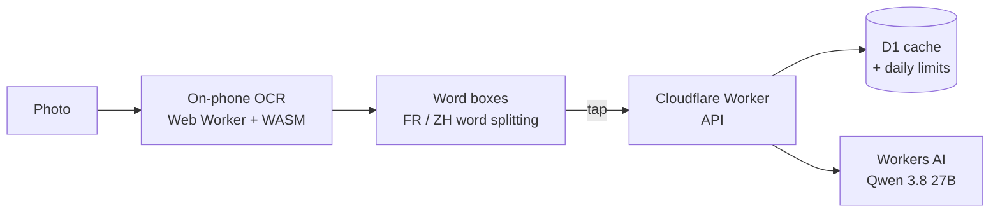

  

  
  
  

  
  

## About

**Point, tap, understand.** Lingua Camera helps you read and build your vocabulary out in the world. Take a photo of a page, a menu or a street sign, and every word becomes tappable.

- **Currently supported**: French, Mandarin
- **Gives you the word meaning within context**, with the part of speech, in plain English.
- **Pinyin support** for Chinese words.
- **Harder words are highlighted**: words beyond beginner level get a coloured outline, so you know where to look.
- **Private by design**: the text is read on your phone within the browsedr and photos never leave the app

Planned features: hear translated words read aloud, save to a personal word bank.

*Lingua Camera is a personal project for a small group of invited readers and runs at no cost.*

## Layout

**On the phone**

| Part | What it does |
| --- | --- |
| Welcome | Invite links land here: a greeting in three languages, then one tap to the camera |
| Camera | Live viewfinder, or pick a photo from the gallery; a language switch (FR / 中文) |
| Word boxes | A tappable box over every word, styled by difficulty (normal, key word, saved) |
| Translation sheet | Slides up with the meaning, part of speech and pinyin; tap another word to switch |

**In the repo**

| Folder | What's in it |
| --- | --- |
| [web/](web/README.md) | The phone app (React) |
| [worker/](worker/README.md) | The server: API, database, AI prompts |
| [shared/](shared/README.md) | Data shapes and limits used by both |
| [docs/](docs/) | The product spec, design decisions and brand assets |

## How it's built

| Area | Choice |
| --- | --- |
| Front end | TypeScript, React 19, React Router, Vite; installable PWA with a service worker |
| Reading text | PaddleOCR (PP-OCRv5 mobile models), running in the browser on ONNX Runtime (WASM, multi-threaded) |
| Word splitting | `Intl.Segmenter` for both languages; Chinese pinyin computed on the phone |
| Back end | Cloudflare Worker with Hono, D1 (SQLite) database |
| Translation | Qwen 3.8 27B on Cloudflare Workers AI, with versioned prompts |
| Validation | Zod schemas shared by the app and the server; every request and model answer is checked |
| Quality | Vitest unit tests, Playwright browser tests at phone width, CI/CD on GitHub Actions (deploys `main` after checks pass) |

A few decisions worth noting:

- **One origin only.** The app loads nothing from other sites (no CDNs, Google Fonts or analytics), enforced by a strict Content Security Policy.
  Most third-party hosts are blocked in mainland China, so this keeps the app working there.
- **Photos stay on the phone.** OCR runs in the browser; the server only ever sees the tapped word and its sentence.
- **About 30 MB of OCR models download once** and are cached on the phone, so later photos read offline.
- **Fast and free.** Repeat lookups come from a shared cache, and each user has a daily limit,
  so the free AI allocation can't run out. Median lookup time is measured from the server logs.

The full plan is in [docs/SPEC.md](docs/SPEC.md); structural decisions are in [docs/DECISIONS.md](docs/DECISIONS.md).

## Licensing

Lingua Camera's code is released under the [Apache License 2.0](LICENSE).

It builds on these open projects:

| Component | Used for | Licence |
| --- | --- | --- |
| [PaddleOCR.js](https://github.com/PaddlePaddle/PaddleOCR) and PP-OCRv5 mobile models | Reading text on the phone | Apache-2.0 |
| [ONNX Runtime Web](https://github.com/microsoft/onnxruntime) | Running the OCR models | MIT |
| [OpenCV.js](https://github.com/opencv/opencv) | Image processing for OCR | Apache-2.0 |
| [Clipper](https://www.npmjs.com/package/clipper-lib) | Polygon maths for OCR | Boost Software License 1.0 |
| Qwen 3.8 27B (via Cloudflare Workers AI) | Meanings in context | To confirm |
| [pinyin-pro](https://github.com/zh-lx/pinyin-pro) | Pinyin with tone marks | MIT |
| [Lexique 3.83](http://www.lexique.org/) | French word frequency (key words) | CC BY-SA 4.0 |
| HSK 3.0 word lists | Chinese beginner vocabulary (key words) | MIT |
| React, React Router, Vite, Hono, Zod | App and server frameworks | MIT |
| DM Sans, DM Serif Display, Space Grotesk | Brand fonts, bundled with the app | SIL Open Font License 1.1 |

Full credits for the word lists are in [web/src/tiers/data/NOTICE.md](web/src/tiers/data/NOTICE.md), and the font licences in [web/src/fonts/](web/src/fonts/).
